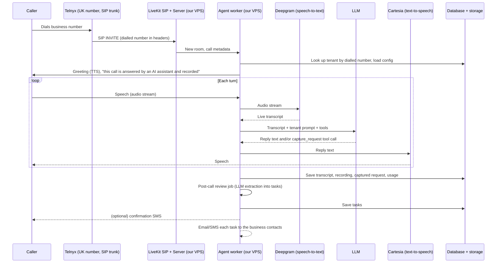

# AI voice agent: research and plan

Status: research and planning, October 2026. Nothing here is built yet.

This is the plan for an AI voice system that answers a real UK phone number. It's the "Phones, bookings and
enquiries" service on the SolwAI home page ("an AI receptionist that answers calls around the clock").

It continues an earlier planning chat. That chat settled the overall stack, chose a message-taker over booking as
the first version, and sketched the multi-tenant design. Those decisions are summarised in
[Decisions carried over](#decisions-carried-over) and not argued again here. This document narrows the scope to the
**first version** and fills in the options, hosting, third-party dependencies and a recommendation.

## Contents

1. [Scope of the first version](#scope-of-the-first-version)
2. [Decisions carried over](#decisions-carried-over)
3. [How a call works](#how-a-call-works)
4. [Technical options](#technical-options)
5. [Hosting implications](#hosting-implications)
6. [Third-party dependencies](#third-party-dependencies)
7. [Costs](#costs)
8. [Recommendation](#recommendation)
9. [Data model](#data-model)
10. [Transcription and review pipeline](#transcription-and-review-pipeline)
11. [Compliance (UK)](#compliance-uk)
12. [Risks](#risks)
13. [Phased plan](#phased-plan)
14. [Open questions](#open-questions)
15. [Sources](#sources)

## Scope of the first version

**In scope**

1. **Voice chat:** answer the call, greet the caller in the business's name, hold a natural two-way conversation
   (turn-taking, barge-in, no long pauses).
2. **Simple enquiries:** answer from the business's own information (opening hours, location, services, prices it's
   happy to give, FAQs). If it doesn't know, it says so and takes a message.
3. **Capture during the call:** fill in a structured request (name, callback number, what they want, preferred time,
   urgency) and read it back to the caller to confirm.
4. **Transcription:** store a full transcript (and, if the business opts in, the recording) for every call.
5. **Review into follow-up tasks:** after the call, an LLM reviews the transcript and creates follow-up tasks (for
   example "Mrs X wants a price for a boiler service" or "Mr Z wants an appointment Thursday afternoon"). They're
   delivered to the business's website **Admin → Messages** screen alongside contact form messages, and emailed. There
   they can be marked as dealt with (see [Delivery into Admin → Messages](#delivery-into-admin--messages)).

**Out of scope for now**

- Booking into calendars (later: booking with a human in the loop, then automatic booking)
- Live transfer to a person (worth adding soon after; out-of-hours fallback is covered by trunk failover)
- Outbound calls, payments, languages other than English
- Self-service onboarding (the first tenants are set up by hand)

**Hard rule:** the agent never confirms anything it can't do. It says "I'll pass that on and they'll get back to you
to confirm", never "you're booked in".

## Decisions carried over

From the earlier chat:

| Decision | Detail |
| --- | --- |
| Rent the phone network and AI models; self-host the plumbing; build the product | Phone numbers and SIP trunk from Telnyx (Twilio as the alternative). Speech-to-text, LLM and text-to-speech as APIs. LiveKit Server + LiveKit SIP + LiveKit Agents self-hosted. Portal, prompts, knowledge and task handling built in-house. |
| Message-taker first, booking later | Structured capture during the call, read back, and a post-call summary. Next comes "booking with a human in the loop": the owner gets a text with Confirm / Suggest another time. |
| Multi-tenant from day one | One agent codebase. **The number that was dialled identifies the tenant.** Every business gets its own number on our trunk; businesses keeping an existing number forward it to theirs. Every table carries `tenant_id`. Anything that varies by business lives in `tenant_config`, never in code. |
| First tenants | SolwAI itself and the club (QoS Community Trust). They're different enough to show up anything hard-coded. |
| Failover | Per-number failover on the trunk (to the business's mobile or voicemail) when our server is down. |
| Data protection | We're the data processor for each business; they sign terms and a data processing agreement listing our sub-processors. |

Decided in this round, for the test phase:

| Question | Decision |
| --- | --- |
| Numbers | **Forward existing lines.** Each business keeps its number and forwards it to its own Telnyx number, so the dialled number still identifies the business. |
| Recordings | **Transcripts only by default.** Recording is a per-business opt-in (`recording_enabled`, off by default). |
| Delivery of tasks | **Email to start, plus the existing Admin → Messages screen** in each business's Gleam site. No SMS yet, and no separate task inbox in a voice portal for now. |
| When the agent answers | **Every call, 24/7** while testing (unconditional forwarding). Answering only on no-answer or out of hours is a per-business setting for later. |
| Voice | **One default British voice for everyone** (Cartesia's default British voice). Per-business voices later. |
| Budget | Doesn't change the build. Covered by spending guardrails instead (see [Costs](#costs)). |

## How a call works



Each turn has a budget of about 800 ms to 1.2 s from when the caller stops speaking to when the agent starts
talking. The pieces that use it up are: end-of-speech detection (~200-400 ms), speech-to-text finalisation
(~100-300 ms), LLM first token (~200-500 ms) and text-to-speech first audio (~100-200 ms). Network round trips
between our VPS and each API add to every step. That's why the model choices and server location below matter.

## Technical options

There are three broad ways to build it. Within the third, each component has its own options.

### Option A: hosted voice-agent platform

Vapi, Retell AI, ElevenLabs Agents, Synthflow, Bland. You configure the prompt and tools in their dashboard, connect
a number (theirs, or your own Twilio/Telnyx number) and receive webhooks with transcripts and call data.

| For | Against |
| --- | --- |
| Working pilot in days, not weeks | $0.07-0.30 per minute all in, roughly 2-5 times the self-built cost |
| Turn-taking, interruptions and latency tuning done for you | Multi-tenancy, portal and data still have to be built on top |
| Built-in call logs and transcripts | Call audio and transcripts sit on their platform (another sub-processor, often US) |
| | Less control over voice, prompt flow and failure handling; price and API changes are out of our hands |

### Option B: phone provider's own AI layer

Twilio ConversationRelay (Twilio does speech-to-text and text-to-speech and sends text to your server over a
WebSocket), or Telnyx's AI Assistants.

| For | Against |
| --- | --- |
| No media server to run; you only write a WebSocket text handler | Locks the voice pipeline to one carrier |
| Simple architecture | Fewer choices of speech and voice providers; ConversationRelay reportedly adds about $0.07/min (not confirmed on Twilio's pages) |

### Option C: open-source voice framework on our own servers (chosen in the earlier chat)

The framework handles the audio pipeline, turn-taking and interruptions; we choose each model provider.

| Framework | Notes |
| --- | --- |
| **LiveKit Agents** (Apache 2.0, Python first, also Agents JS) | Native SIP through LiveKit SIP; Telnyx and Twilio both have LiveKit setup guides; built-in voice activity detection and a turn-detection model; plugins for Deepgram, Cartesia, ElevenLabs and Anthropic. Most widely used (about 4x Pipecat's downloads). The same code runs on self-hosted LiveKit or LiveKit Cloud. |
| **Pipecat** (BSD-2, Python, from Daily) | Flexible pipeline; telephony mostly through Daily or WebSocket transports from Twilio/Telnyx. Daily's own transport gets first-class support. |

Component choices within option C:

| Component | Options | Pick for v1 | Why |
| --- | --- | --- | --- |
| Phone numbers + SIP trunk | Telnyx, Twilio, Sinch, Vonage | **Telnyx** | Owns its network, cheaper per minute than Twilio, UK numbers, LiveKit guide, per-number failover, GBP billing. Twilio is the fallback: UK inbound about $0.01/min plus about $3.50/month per local number. |
| Media / SIP server | LiveKit self-hosted, LiveKit Cloud, Asterisk/FreeSWITCH + custom bridge | **LiveKit self-hosted** | Free and open source; LiveKit Cloud is the escape hatch if running UDP media ourselves proves painful (same agent code). |
| Turn-taking | LiveKit's Silero voice activity detection + turn-detector model | **Built in** | Free, runs on CPU. |
| Speech-to-text (live) | Deepgram Nova-3, AssemblyAI Universal-Streaming, Speechmatics, self-hosted Whisper | **Deepgram Nova-3** | Low latency on phone audio, about $0.0048/min. Speechmatics is the strongest choice if Scottish accents prove a problem (it's UK-based, which also helps the data story); test both on real calls. Self-hosted Whisper needs a GPU and is slower. |
| LLM (live conversation) | Claude Haiku 5.5, Claude Sonnet 5.5, others | **Claude Haiku 5.5** (`claude-haiku-5-5`), thinking off | Fast first token, which matters more than depth here, and very cheap at $0.10 / $0.50 per million tokens. The conversation is short and the tenant prompt fits in the context, so use prompt caching on it. Step up to Sonnet 5.5 only if real calls show it's needed. |
| LLM (post-call review) | Claude Opus 5.5, Sonnet 5.5, Haiku 5.5 | **Claude Opus 5.5** (`claude-opus-5-5`) with structured outputs | Not time-critical. Accuracy is what matters, since a wrong task is worse than a slow one. About 3-5 US cents per call at typical transcript sizes. Sonnet 5.5 is the cheaper alternative if volumes grow. |
| Text-to-speech | Cartesia Sonic 3, ElevenLabs Flash, Deepgram Aura, OpenAI TTS | **Cartesia Sonic 3** | Low first-audio latency, about $35 per million characters, natural British voices. ElevenLabs Flash ($0.05 per 1,000 characters) if a tenant wants a particular voice. |
| Recording + transcript storage | MinIO/local disk on VPS, S3-compatible (Backblaze, Cloudflare R2) | **S3-compatible bucket in the UK/EU** | Keeps bulky audio off the VPS disk. |
| Database | MySQL, Postgres, SQLite | **MySQL** (as in the earlier chat) | Already run in containers on the existing stack. Shared by the agent, review job and portal. |
| Notifications | Telnyx SMS, email via SMTP/Postmark | **Email through each business's Gleam site (Admin → Messages); SMS later** | Uses the email set-up the sites already have; SMS for urgent tasks and caller confirmations once needed. |
| Background jobs | Simple DB-backed queue, Redis queue | **DB-backed queue** | The review job runs once per call; volume is tiny. LiveKit already needs Redis if we want it later. |

### Not chosen: speech-to-speech models

Realtime speech-to-speech models (one model hears audio and speaks back) give the lowest latency and the most
natural prosody. Against them for v1: higher cost per minute, less control over exactly what's said, harder to make
the agent read back numbers reliably, and a single provider for the whole pipeline. Revisit once the message-taker
works. LiveKit Agents supports them, so the switch would be contained.

## Hosting implications

The voice side **can't sit behind a Cloudflare Tunnel** like the websites do. SIP signalling and call audio (RTP) are
UDP and need a public IP with ports open. That decides most of the rest:

1. **A separate VPS for voice**, not the website host. Suggested size: 4 vCPU / 8 GB RAM. LiveKit, the SIP bridge
   and 5-10 simultaneous calls' worth of agent workers fit comfortably; speech recognition and voice run at the
   providers, so no GPU is needed. About £20-40/month.
2. **Location: London.** Telnyx has London points of presence. Every turn makes calls to speech-to-text, the LLM and
   text-to-speech, mostly hosted in the US/EU. Being close to the carrier and on a well-connected network matters more
   than CPU. Measure round-trip times from the chosen VPS to each provider before committing.
3. **Firewall ports** (check against LiveKit's self-hosting docs; third-party guides differ on the ranges):
   - 5060/UDP (SIP signalling), **allow only Telnyx's signalling IP ranges**
   - 10000-20000/UDP (SIP audio/RTP)
   - 7880/TCP (LiveKit API/WebSocket; can stay internal, or go behind the reverse proxy)
   - 7881/TCP and 50000-60000/UDP (LiveKit WebRTC media; only needed if browsers join calls, such as a "test call
     from the portal" button)
   - 5061/TCP if we move SIP to TLS later
   The Fasthosts VPS firewall has caused trouble before. Test UDP reachability early, and keep LiveKit Cloud as the
   fallback media layer if it can't be made reliable.
4. **Docker Compose stack** (Portainer, like the existing sites): `livekit`, `livekit-sip`, `redis`, `agent` (scales
   to N workers), `review-worker`, `portal`, `mysql`. LiveKit and its SIP bridge use host networking because of the
   large UDP port ranges.
5. **The portal can go behind Cloudflare Tunnel as usual.** It's ordinary HTTPS, and the same applies to webhooks
   from Telnyx.
6. **Availability:** a phone line is expected to work at 3 a.m.
   - Telnyx per-number failover sends calls to the business's mobile/voicemail if our SIP endpoint doesn't answer.
   - Uptime Kuma (already in use) checks the LiveKit health endpoint, and a scheduled test call checks the full path.
   - Second small VPS (~£10-20/month) for monitoring and, later, a warm standby.
7. **Backups:** the MySQL dump and the recordings bucket follow the existing backup routine; recordings expire on a
   per-tenant retention schedule.
8. **Secrets:** API keys for Telnyx, Deepgram, Anthropic and Cartesia go in the stack's environment, never in the
   repo.

## Third-party dependencies

| Supplier | Used for | Data it sees | Sub-processor? | If it fails |
| --- | --- | --- | --- | --- |
| Telnyx | UK numbers, SIP trunk, SMS | Call audio in transit, caller number, SMS content | Yes | Calls fail; no in-house fallback (could port numbers to Twilio, which takes days) |
| Deepgram | Live speech-to-text (+ optional post-call re-transcription) | Call audio | Yes | Agent can't hear: fall back to "please leave a message" plus recording; switch provider in config (AssemblyAI/Speechmatics plugins exist) |
| Anthropic | LLM (conversation and review) | Transcript text, tenant knowledge | Yes | Agent falls back to message-taking from a fixed script; review jobs retry |
| Cartesia | Text-to-speech | Reply text | Yes | Fall back to a second TTS provider (ElevenLabs or Deepgram Aura) |
| LiveKit (open source) | Media server, SIP bridge, agent framework | None (self-hosted) | No | Our own server, so failover on the trunk applies |
| VPS provider | Hosting | Everything at rest | Yes | Trunk failover; restore from backup |
| Object storage (S3-compatible) | Recordings, transcripts | Recordings | Yes | Writes queue on local disk |
| Email (each site's existing SMTP) | Task notifications | Task summaries | Yes | Tasks are still in Admin → Messages |
| Stripe (later) | Billing | Business billing details only | Yes | Not on the call path |

Every supplier that touches call data goes in the sub-processor list in the data processing agreement, along with
its data location. Several are US-based, so this needs the UK's international transfer mechanisms (the UK-US data
bridge or contract clauses), which each supplier's DPA should provide. Prefer EU/UK processing where offered
(Deepgram and Speechmatics have EU options).

## Costs

List prices from public pricing pages and third-party summaries, in US dollars unless marked. **Check each provider's
UK price sheet before quoting customers.** No published Telnyx UK per-minute inbound rate was found; the Telnyx
figures are US list rates.

**Per call minute (self-built, option C)**

| Item | Approx. per minute |
| --- | --- |
| Telnyx inbound + SIP | ~$0.003-0.01 |
| Deepgram Nova-3 streaming | ~$0.005 |
| Claude Haiku 5.5 (live conversation, cached tenant prompt) | ~$0.001-0.003 |
| Cartesia Sonic 3 (agent speaks part of each minute) | ~$0.01-0.02 |
| **Total live call** | **~$0.02-0.04** |
| Post-call review (Claude Opus 5.5, per call, not per minute) | ~$0.03-0.05 per call |

**Fixed:** about £30-60/month (voice VPS plus monitoring VPS), about $1-2/month per number.

**Example tenant:** 100 calls a month at 3 minutes each (300 minutes) comes to about $6-12 in call costs plus about
$3-5 in reviews. On a hosted platform the same calls would cost about $21-90. UK competitors charge about £69-299 a
month.

**Budget doesn't change the architecture.** The same stack costs the same per minute at 10 calls or 10,000; only the
server size grows. The budget only shapes guardrails, which matter more with 24/7 answering (spam and robocalls
cost minutes too):

- A maximum call length (for example 10 minutes) and a silence timeout in the agent
- A per-business monthly minute cap, after which calls go to the failover number
- Prepaid balances or hard spend limits and low-balance alerts in the Telnyx, Deepgram, Anthropic and Cartesia
  accounts
- A daily cost summary per business from the `cost_breakdown` logged on each call

Pricing for customers can wait until the pilot shows real call volumes.

## Recommendation

**Build option C as agreed in the earlier chat, scoped to the message-taker:**

- **Telnyx** UK numbers and SIP trunk, one number per tenant, per-number failover to the business's mobile
- **Self-hosted LiveKit Server + LiveKit SIP** on a dedicated London VPS with public UDP (not behind Cloudflare
  Tunnel), run as a Portainer stack
- **LiveKit Agents (Python)** for the agent, with built-in voice activity and turn detection
- **Deepgram Nova-3** for live speech-to-text; run a side-by-side test with Speechmatics on real local calls in week 1
- **Claude Haiku 5.5** for the live conversation, with a `capture_request` tool and an `answer_from_knowledge`
  approach (tenant knowledge in a cached prompt, no vector database)
- **Cartesia Sonic 3** for the voice
- **Claude Opus 5.5 with structured outputs** for the post-call review that turns transcripts into tasks
- **MySQL** for tenants, calls, transcripts and tasks; **S3-compatible UK/EU bucket** for recordings
- **Tasks delivered into each business's Gleam site (Admin → Messages) and by email**, using the site's existing
  mail set-up. SMS via Telnyx comes later. The **voice portal** starts as an internal admin screen for us (businesses,
  numbers, profiles, call list, transcripts) rather than something customers sign in to.

Why this over a hosted platform: the multi-tenant data, portal and task handling have to be built either way. The
self-built pipeline costs roughly a third as much per minute, keeps call data on our own server with fewer
sub-processors, and fits the existing Docker/Portainer skills. What we give up is speed to first demo and having
someone else tune latency. If the UDP/firewall side becomes a time sink, **move the media layer to LiveKit Cloud
without changing the agent code** rather than switching to a hosted platform.

**Language and repo:** build it as a new repository (for example `solwai-voice`), not inside this site engine. The
agent should be Python because LiveKit Agents is Python-first and its plugins land there first. The portal can be
Node/Express in the style of this engine. This engine's admin screens, accounts and change history are a good model,
but the voice portal has a different data model and must be multi-tenant.

## Data model

Minimum tables (MySQL). Every table except `tenants` carries `tenant_id`; every portal query filters on the tenant
from the signed-in user, never from the browser.

| Table | Key columns |
| --- | --- |
| `tenants` | id, name, status, timezone, plan |
| `phone_numbers` | e164 (unique), tenant_id, telnyx_id, failover_number |
| `tenant_config` | tenant_id, greeting, persona, business_info, faqs, opening_hours, out_of_hours_message, rules (for example "never quote prices"), voice_id, recording_enabled, retention_days |
| `notification_contacts` | tenant_id, name, email, mobile, notify_on (all / urgent only) |
| `users` | id, tenant_id (null for platform admin), email, password_hash, role |
| `calls` | id, tenant_id, caller_number, dialled_number, started_at, ended_at, duration_s, end_reason, recording_key, cost_breakdown (JSON) |
| `transcript_turns` | call_id, tenant_id, seq, speaker (caller/agent), text, start_ms, end_ms, stt_confidence |
| `captures` | call_id, tenant_id, payload (JSON from the in-call `capture_request` tool), confirmed_by_caller |
| `tasks` | id, tenant_id, call_id, type, title, details, caller_name, callback_number, preferred_time, urgency, confidence, needs_review, status (new / in progress / done / dismissed), assigned_to, created_at, done_at, delivered_at (to the site's Admin → Messages), delivery_attempts |
| `jobs` | id, tenant_id, kind (review / notify), call_id, status, attempts, last_error |

## Transcription and review pipeline

**During the call**

- Deepgram streams interim and final transcripts. Final turns are saved to `transcript_turns` as the call goes on,
  so a dropped call still leaves a transcript.
- The LLM fills in `capture_request` as it learns details. Before ending the call it reads them back: "So that's a
  quote for a boiler service, best number is the one ending 432, and Thursday afternoon suits you?" Phone numbers and
  name spellings are where speech-to-text slips most, so the caller ID is used as the default number and confirmed,
  and surnames are spelled back.
- The recording (if enabled for that tenant) is written by LiveKit Egress or the agent to the bucket.

**After the call (review job)**

1. The call ends, and a `review` job is queued.
2. Optional: re-transcribe the recording with Deepgram's pre-recorded model, which is more accurate than streaming,
   and keep both versions.
3. Send the transcript, the in-call capture, the tenant's business info and the caller ID to Claude Opus 5.5 with a
   **structured output schema**:

   ```json
   {
     "summary": "One or two sentences on what the call was about",
     "caller": { "name": "Mrs X", "callback_number": "+447...432", "number_confirmed": true },
     "tasks": [
       {
         "type": "price_request | appointment_request | callback | complaint | information | other",
         "title": "Price for boiler service",
         "details": "3-bed semi, combi boiler, wants a quote before booking",
         "preferred_time": "Thursday afternoon",
         "urgency": "low | normal | urgent",
         "confidence": "high | medium | low",
         "evidence": "Short quote from the transcript supporting this task"
       }
     ],
     "unanswered_questions": ["Asked whether they cover Lockerbie; agent didn't know"],
     "agent_issues": ["Agent quoted opening hours that differ from the profile"],
     "spam_or_silent": false
   }
   ```

4. Save the tasks. Set `needs_review` when confidence is low, the review disagrees with the in-call capture (for
   example a different callback number), or the call was cut off before read-back.
5. Deliver each task to the business's Gleam site (Admin → Messages), which stores it and emails it with the site's
   existing mail set-up. See the next section. SMS for urgent tasks comes later.
6. **Quality loop:** `unanswered_questions` and `agent_issues` go to a per-tenant "improve your answers" list in the
   portal. Each gap the owner fills in becomes new knowledge for the agent. This is how the agent gets better, and it
   shows what callers actually ask for before booking is built.

**Review by the business**

Staff see phone messages in Admin → Messages next to contact form messages and mark them as dealt with in the same
way. Each phone message shows the caller's number, the urgency, any preferred time, the summary, the supporting
quote, and a link to the full transcript. Flagged ("please check") messages stand out.

### Delivery into Admin → Messages

The first two businesses (SolwAI and the club) both run on this site engine, and each site already keeps contact
form messages under **Admin → Messages** (the `messages` table in each site's SQLite database) and emails them
through `src/mail.js`. Phone messages go into the same place, so staff have one list to work through.

Each site has its own container and database, so the voice system can't write into them directly. Instead each
site gets a small authenticated endpoint, and the voice system's review job calls it.

**Built in this engine** (see "Phone messages from the AI voice agent" in the [main README](../../README.md)):

- `VOICE_API_TOKEN` setting. While it's blank the endpoint doesn't exist (`404`).
- `POST /api/inbound/voice-message` with `Authorization: Bearer <token>`. JSON fields: `ref` (required, unique per
  message: the call ID plus the task number), `message` (required), `name`, `phone`, `topic`, `urgency`
  (`low` / `normal` / `urgent`), `preferred_time`, `needs_review`, `transcript_url`, `at`. Returns `201` when
  stored, or `200` with `duplicate: true` if that `ref` is already stored, so retries are safe. Repeated bad tokens
  from one address are slowed down (`429`).
- New columns on `messages`, added automatically to existing databases: `source` (`form` / `phone`), `phone`,
  `urgency`, `preferred_time`, `ref` (unique), `transcript_url`, `needs_review`.
- Admin → Messages is retitled "Messages" and has All / Website / Phone filter buttons. Phone messages show a tap-to-call
  link (or "Number withheld"), Urgent and "Please check" badges, the preferred time and a "Read the transcript"
  link. The reply-by-email subject for website messages now uses the site's name instead of a hard-coded one.
- Phone messages are emailed to `CONTACT_TO` with the site's existing SMTP settings. Urgent and uncertain messages
  are flagged in the subject.

**On the voice side:** `tenant_config` gets `site_url` and `site_token` (stored encrypted) for each business. The
review job sends one request per task (`ref` = call ID + task number) and retries with back-off until the site accepts it. The transcript link
points to the voice system's transcript page. Until the voice portal has sign-in for business staff, that page uses
a long, unguessable, expiring link.

A business that doesn't run on this engine gets the same tasks by email only. A customer-facing task inbox in the
voice portal can come later if that becomes common.

## Compliance (UK)

To confirm with the ICO's own guidance (and a solicitor before charging customers). The points below are the working
position, not legal advice.

- **Tell callers at the start** that they're speaking to an AI assistant and that the call is recorded/transcribed,
  with where to find the privacy notice. Keep it short: "Hi, you've reached {business}. I'm their AI assistant; calls
  are recorded so we can pass your message on."
- **Lawful basis:** the business (controller) will usually rely on legitimate interests to handle enquiries. A
  documented balancing test, and a data protection impact assessment, are sensible given that voice recordings and AI
  are involved. We're the processor.
- **Retention:** per-tenant setting with a short default (for example recordings 30 days, transcripts and tasks 12
  months). Automatic deletion job.
- **Caller rights:** be able to find and delete all data for a caller number per tenant.
- **Special category data:** callers may mention health. Tell the agent not to probe for it, and keep it out of SMS
  notifications.
- **International transfers:** list each supplier's location and transfer mechanism in the sub-processor list.
- **Ofcom:** inbound-only calls avoid most outbound-calling rules. Some vendor blogs claim there's an Ofcom rule
  requiring AI disclosure within the first seconds of a call; no primary source was found, but disclosing in the
  greeting covers it either way.

## Risks

| Risk | Mitigation |
| --- | --- |
| Speech-to-text struggles with local accents and phone line quality | Test Deepgram vs Speechmatics on recorded test calls from local voices in week 1; read back key details; flag low confidence for review |
| Latency makes calls feel robotic | London VPS, fast models, streaming everything, LiveKit turn detector; measure each component's latency per turn and log it |
| Agent invents answers or makes promises | Hard rules in the base prompt; answer only from tenant knowledge; post-call `agent_issues` check; review sample calls weekly |
| UDP/firewall problems on the VPS | Test UDP early; LiveKit Cloud as the fallback media layer |
| Our server down at night | Telnyx per-number failover to the business's mobile/voicemail; Uptime Kuma; scheduled test call |
| Cross-tenant data leak | Tenant from the signed-in user only; automated isolation test; per-tenant storage paths |
| Provider price or API changes | Each provider sits behind a LiveKit plugin or a thin interface; switching is configuration plus testing |
| Spam and robocalls use up minutes | Max call length, silence timeout, per-tenant concurrency cap, spam flag from the review |

## Phased plan

**Phase 0: spike (about 1 week)**
- Telnyx account, one UK number, LiveKit + SIP on a test VPS, the LiveKit "hello world" voice agent answering calls
- Measure per-turn latency; prove UDP works through the VPS firewall; record test calls for the accent test

**Phase 1: message-taker for tenant #1, SolwAI (about 2-3 weeks)**
- Tenant lookup by dialled number, `tenant_config`-driven prompt template, `capture_request` tool with read-back
- Transcript storage (recording off by default), review job with structured output
- ~~Inbound voice-message endpoint and phone messages in Admin → Messages in this engine~~ (done); set `VOICE_API_TOKEN` on the SolwAI site
- Internal voice admin screens: businesses, numbers, profile editor, call list with transcript
- Guardrails: maximum call length, silence timeout, monthly minute cap, provider spend limits

**Phase 2: second tenant, the club (about 1-2 weeks)**
- Onboard QoS Community Trust from config only (anything that needs a code change is a bug to fix); forward the club's existing line
- Needs-review flags, "improve your answers" list, retention job, isolation test
- Failover tested by stopping the server mid-day

**Phase 3: pilot with 2-3 local businesses**
- Data processing agreement and sub-processor list, usage metering per tenant, admin view across tenants
- Decide the next feature from real calls: warm transfer, booking with a human in the loop, SMS notifications, or answering only on no-answer/out of hours
- Set customer pricing from real call volumes

## Open questions

The first round is answered; see the decisions table under [Decisions carried over](#decisions-carried-over). Still
to settle:

1. Which number does the club forward, and is that line on a phone system that can forward unconditionally (most
   BT lines and VoIP systems can)?
2. Who receives the club's phone messages by email: the site's existing `CONTACT_TO` address, or someone else?
3. Wording of the greeting and AI disclosure for each business.

## Sources

- [Telnyx SIP trunking pricing](https://telnyx.com/pricing/elastic-sip), [Telnyx UK numbers](https://telnyx.com/phone-numbers/united-kingdom), [Telnyx LiveKit configuration guide](https://developers.telnyx.com/docs/voice/sip-trunking/livekit-configuration-guide)
- [Twilio UK voice pricing](https://www.twilio.com/en-us/voice/pricing/gb)
- [LiveKit: Telnyx trunk setup](https://docs.livekit.io/sip/quickstarts/configuring-telnyx-trunk), [LiveKit: SIP trunk setup](https://docs.livekit.io/telephony/start/sip-trunk-setup/), [LiveKit vs Pipecat](https://livekit.io/field-guides/guide/livekit-vs-pipecat), [Pipecat vs LiveKit Agents (Fora Soft)](https://www.forasoft.com/blog/article/pipecat-vs-livekit-agents)
- [Self-hosted LiveKit SIP ports example (Sinch)](https://developers.sinch.com/docs/est/integration-guides/livekit), [Self-hosted LiveKit SIP example (La Suite Meet)](https://documentation-meet.beta.numerique.gouv.fr/self-hosting/configuration/telephony/)
- [Voice agent platform comparison (Morph)](https://www.morphllm.com/best-ai-voice-agent-platforms), [Vapi vs ElevenLabs (Retell)](https://retellai.com/blog/vapi-vs-elevenlabs), [Twilio voice pricing explained (Quiq)](https://quiq.com/blog/twilio-voice-pricing/)
- Deepgram, Cartesia and ElevenLabs prices as gathered in the earlier chat (DIY AI and Toolradar Deepgram pricing summaries, Dupple's 2026 TTS round-up, Fora Soft's ElevenLabs alternatives); check against each provider's own pricing page
- UK competitor pricing: [Softomate AI receptionist](https://www.softomatesolutions.com/blog/voice-calling-api-uk-businesses-2026/)
- UK compliance (vendor guides, to be checked against ico.org.uk): [Softomate GDPR/PECR and call recording](https://www.softomatesolutions.com/blog/gdpr-pecr-call-recording-ai-voice-agents-uk-2026/), [Ainora UK GDPR guide](https://ainora.lt/blog/ai-receptionist-uk-gdpr-ico-compliance-guide)
- Claude model IDs and prices: Anthropic API reference (cached October 2026)
